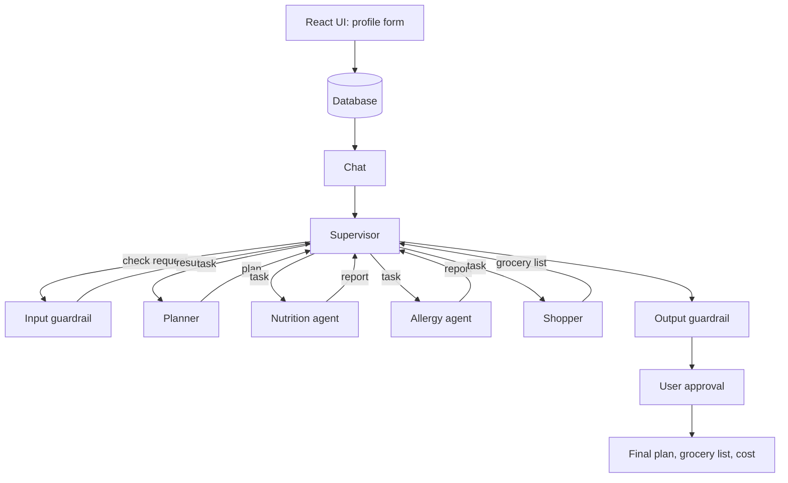

# Meal Planner Multi-Agent System: Plan and Architecture (v5)

## 1. What we are building

A web app where a team of AI agents makes a safe meal plan and a grocery list.

1. The user **creates a profile** first (age, weight, allergies, and so on).
2. Then a **chat** opens. The user says things like "Plan 1,800 calories a day for 5 days. Keep eggs, bread, and milk for breakfast."
3. The agents work together, check each other's work, and return the meal plan, grocery list, and estimated cost.

The use case is simple, so the focus stays on the agents: how they are organized, how they use tools, how they block unsafe results, and how much freedom each one gets.

---

## 2. User flow

1. **Create profile.** The data is saved in the database.
2. The UI shows: "Your profile has been created. Tell me what you'd like to plan."
3. **Chat opens.** The user sends a request.
4. The **Supervisor** reads the message, extracts the details, and runs the input guardrail.
   - Safe → "Okay, I can plan this" and the agents start.
   - Not safe → the system says it is not advised for this profile and shows the safe range. It never suggests a range on its own.
5. The Supervisor runs the agents, one step at a time (see section 5).
6. The user sees the plan, grocery list, and estimated cost, then approves.

**Days rule:** "tomorrow" = 1 day, "for 3 days" = 3 days, "a week" = 7 days. If the user does not say how many days, the app asks (naturally, mentioning the 7-day maximum); it never assumes a length. Everything else they already asked for (cuisine, exclusions, diet, calories, locked meals) is kept with the open question, so their answer completes the request.

---

## 3. The profile

| Field | Why |
|---|---|
| Name | Display only |
| Age | Safe calorie check. Under 18 → no plan, suggest a doctor or dietitian |
| Sex, height, weight | Calorie formula |
| Activity level (low / medium / high) | Calorie formula |
| Goal (lose / maintain / gain), optional | Helps the guardrail catch odd requests |
| Diet type (veg / non-veg / vegan) | Planner and conflict checks |
| Disliked foods | Planner |
| Allergies (dropdown, plus an "Other" box) | Allergy agent |
| Standing fixed meals, optional | Default fixed meals for every plan |

The user can edit the profile later. If allergies change, old plans must be re-checked.

---

## 4. The agents

| Agent | Goal | Tools | Can it block? |
|---|---|---|---|
| **Supervisor** | Run the whole workflow and be the only one who assigns work | Database, input guardrail, export | Yes, can stop the loop |
| **Planner** | Plan meals (3 a day, ingredients in grams), keep fixed meals locked | Recipe API search, unit converter | No |
| **Nutrition** | Check calories and macros per meal and per day | USDA FoodData Central API | Soft block (asks for changes) |
| **Allergy** | Confirm the plan is safe for the user's allergies | Database (allergy list, allergen sources), ingredient lookup | **Hard veto** |
| **Shopper** | Build the grocery list and cost estimate | Merge function, Mandi/Agmarknet price API | No |

The input guardrail is not an agent. It is plain code (Mifflin-St Jeor formula) that the Supervisor calls.

---

## 5. Supervisor as the only workflow manager

**Rules of this design:**
- The Supervisor is the **only** agent that assigns work and decides what happens next.
- Worker agents (Planner, Nutrition, Allergy, Shopper) **do not know the others exist**. Each one gets a task and the inputs it needs from the Supervisor, and sends back one report.
- Nutrition and Allergy never see each other's reports. The Planner never talks to either of them. It only gets feedback that the Supervisor passes along.
- There is **no separate router**. The routing logic is a function inside the Supervisor.
- In LangGraph, the only edges are **worker → Supervisor** and **Supervisor → worker**. There are no worker-to-worker edges.

**Supervisor steps:**
1. Read the user's message (LLM) and extract the request type, calories, days, and fixed meals
2. Run the input guardrail (code). If it fails, show the safe range and stop
3. Save everything in shared state and start the **Planner**
4. Read the plan, then start **Nutrition and Allergy in parallel**
5. Wait for both reports, then decide:
   - Both OK → start the **Shopper**
   - Any problem and rounds left → send the plan back to the **Planner** with the feedback
   - Round 3 reached → ask the user what to relax
6. Run the output guardrail and ask the user to approve

**What is LLM and what is code inside the Supervisor:**
- **LLM:** reads the request, analyzes the reports, writes explanations for the user
- **Code:** the safety rules (an allergy veto always sends the plan back), the round limit, timeouts, retries, and writing every decision to the trace log

### Request types (intent)
The first LLM step also works out what kind of request it is:

| Intent | Path |
|---|---|
| `new_plan` | Guardrail → Planner → Nutrition + Allergy → Shopper |
| `edit_meal` | Planner (one meal) → checks → update the grocery list |
| `grocery_only` | Shopper only |
| `explain` | Read the trace log and answer. No planning |

**Build order:** start with `new_plan` only. Then add the other intents one at a time. Only new branches are added, the graph stays the same. A cheaper alternative is React buttons ("Regenerate this meal", "Get grocery list") that tell the backend the path directly.

---

## 6. Architecture



This is a hub-and-spoke design. The Supervisor is in the middle and every worker talks only to it. That gives one place to log, limit, and control everything.

---

## 7. How each agent thinks, acts, and observes

Every worker is an LLM with its own tools that repeats a loop until its goal is met or its step limit is reached:

**Think** (decide the next step) → **Act** (call a tool) → **Observe** (read the result) → repeat.

**Planner** (goal: a 5-day South Indian plan, 1,800 kcal, breakfast locked)
1. Think: I need lunch and dinner ideas. Act: `search_recipes("South Indian")`
2. Observe: only 2 results. Think: try another search term. Act: search again
3. Observe: still short. Think: write the remaining recipes myself and mark them AI-generated
4. Act: `convert_to_grams`. Observe: day totals look about right
5. Done: return the plan

**Nutrition** (goal: verify calories and macros)
1. Think: first ingredient is "idli batter." Act: `lookup_nutrition("idli batter")`
2. Observe: no match. Think: try "rice flour" and "urad dal." Act: look up both
3. Observe: good values. Think: next ingredient, and so on
4. Act: total each day. Observe: day 3 is 350 kcal over
5. Done: return the report with the fix

**Allergy** (goal: confirm the plan is safe)
1. Act: read the user's allergies and the allergen table
2. Observe: no direct matches. Think: "curry paste" is unclear
3. Act: look up what is in curry paste. Observe: may contain shrimp paste
4. Think: the user has a shellfish allergy, so this is a risk
5. Done: veto with the reason (the veto itself is a code rule, the LLM supplies the investigation and the explanation)

**Shopper** (goal: grocery list and cost)
1. Act: `merge_ingredients`. Observe: totals per item
2. Act: `get_prices` for each item. Observe: no data for ghee
3. Think: use an AI estimate and label it. Act: estimate
4. Observe: total cost computed. Done: return the list

**Supervisor** (the outer loop)
1. Think: read the request. Act: extract details and run the input guardrail
2. Act: start the Planner. Observe: plan returned
3. Act: start Nutrition and Allergy in parallel. Observe: both reports
4. Think: veto found, round 1 of 3. Act: send the plan back to the Planner with feedback
5. Repeat until both pass, then start the Shopper

### Autonomy is matched to risk

| Agent | Loop strength | Why |
|---|---|---|
| Planner | Strong | A wrong meal is cheap to fix, and it gets checked afterwards |
| Nutrition | Strong | Name matching needs retries and judgment |
| Shopper | Medium | Adding up quantities is fixed, price fallbacks need judgment |
| Supervisor | Medium | The outer loop is real, but the safety rules are fixed on purpose |
| Allergy | Constrained | A safety check should be predictable. The LLM investigates unclear ingredients, but the veto is a code rule |

Where mistakes are cheap, the agent gets freedom. Where mistakes are dangerous, behavior stays tight. All five are built as LLM-plus-tools agents with a step limit, not as one fixed function call.

### How each agent uses an LLM and code

| Agent | LLM does | Code and tools do |
|---|---|---|
| Supervisor | Reads the message, analyzes reports, writes explanations | Safety rules, round limit, error handling, trace log |
| Planner | Chooses meals, writes AI recipes when the API falls short, fixes the plan from feedback | Recipe API search, unit conversion |
| Nutrition | Decides what to look up, matches names, explains fixes | USDA API call, calorie and macro math |
| Allergy | Investigates unclear ingredients, writes the reason for a veto | Database check of allergies and allergen sources, the veto rule |
| Shopper | Cleans names, groups items, estimates missing prices | Adding up quantities, mandi price API |

**Design rule:** the LLM understands language, makes judgment calls, and writes explanations. Code does the math, database lookups, and safety decisions.

---

## 8. Planner details

### Recipe logic (if / else)
1. Search the recipe API for matching recipes (cuisine, diet type, dislikes).
2. Enough recipes → use them.
3. Not enough (for example South Indian dishes) → use what the API gave and let the AI model create the rest, with ingredients and quantities.
4. Mark each recipe's source: `api` or `ai_generated`. AI recipes are less reliable, so they still go through both checks.

### Where quantities come from
The **Planner** decides them. Each meal has ingredients in grams for one person, sized so the day fits the target. Nutrition verifies. The Shopper only adds them up.

### Meal rules
- 3 meals a day, calories split across them (for example 30% / 40% / 30%)
- Daily total within the target range (for example ±5%)
- No recipe more than twice a week (applies only to meals the Planner chooses)

---

## 9. Fixed meals

The user can lock a meal, for example "eggs, bread, and milk for breakfast, every day." They can say it in chat or save it as a standing preference in the profile.

1. The Supervisor saves `fixed_meals` in shared state.
2. The Planner treats those slots as locked and plans only the other meals.
3. The locked meal's calories are looked up first. The remaining calories are split across the other meals (for example breakfast 400 of 1,800 → the others share 1,400).
4. **Checks still apply to locked meals.** Nutrition counts them in the daily total. Allergy checks them. Conflicts (egg allergy or vegan profile with an egg request) are flagged to the user and never silently dropped.
5. The Shopper includes locked items in the grocery list.

Edge cases:
- **No amounts given:** the Planner picks a standard portion and shows it so the user can change it.
- **Locked meal too big:** if fixed meals leave too few calories for the rest of the day, the guardrail tells the user instead of producing a poor plan.

---

## 10. Tools and what they return

| Agent | Tool | Source | What it returns |
|---|---|---|---|
| Supervisor | `calc_targets` (input guardrail) | Formula in code | Daily calorie need, safe range |
| Planner | `search_recipes` | Recipe API (TheMealDB), then AI fallback | Recipe names, ingredients, quantities, steps |
| Planner | `convert_to_grams` | Code | Quantities in grams |
| Nutrition | `lookup_nutrition` | USDA FoodData Central API | Calories, protein, carbs, fat per 100 g |
| Allergy | `check_allergens` | Database tables | Allergen → hidden sources (nuts → almond, cashew, pesto) |
| Allergy | `lookup_ingredient` | Recipe or food data, then AI knowledge | What an unclear ingredient may contain |
| Shopper | `merge_ingredients` | Code | Total grams per ingredient, rounded to pack sizes |
| Shopper | `get_prices` | Mandi/Agmarknet API, then AI estimate | Price per kg (maximum price), flagged `api` or `ai_estimate` |

**Rule:** all nutrition numbers in the final answer must come from a tool call, not the model's guess.

**Recipe API notes:** TheMealDB is free (test key `1` for development). It has only a few hundred recipes, no nutrition data, and quantities as text ("1 cup"). Check how many dishes it has for the cuisines you care about.

**Price notes:**
- Agmarknet (via data.gov.in) gives daily wholesale min, max, and modal prices for farm commodities. Access can be unreliable. Wrappers like Mandi Price API or CEDA Agri Market API exist.
- We use the **maximum price**. Retail is usually higher than wholesale, so this is closer to a shop price than the modal price but may still be lower. Add a configurable markup if wanted.
- Check the units (possibly per quintal = 100 kg) and convert to per kg.
- Mandi data mostly covers raw produce, grains, and pulses. Missing items use an AI estimate, labeled as an estimate.

---

## 11. Database

| Table | Main columns |
|---|---|
| `users` | id, name, age, sex, height_cm, weight_kg, activity_level, goal, diet_type, dislikes, standing_fixed_meals |
| `user_allergies` | user_id, allergen |
| `allergen_sources` | allergen, ingredient (hidden sources, used by `check_allergens`) |
| `plans` | id, user_id, days, calorie_target, cuisine, status, created_at |
| `plan_meals` | plan_id, day, meal_type, locked, recipe_name, source, ingredients (grams), calories, macros |
| `agent_trace` | task_id, from, to, type, payload, timestamp (audit log and timeline) |
Database: MySQL (`nutrigen`).

---

## 12. Shared state and messages

```
state = {
  user_profile, intent, days, calorie_target, fixed_meals,
  current_plan, plan_version,
  nutrition_report, allergy_report,
  round, max_rounds,
  status: "drafting" | "reviewing" | "approved" | "escalated",
  trace: [ ...messages... ]
}
```

The Supervisor controls the state. Each worker is given only the part it needs. Each agent also has its own small private memory (for example, the Planner remembers "user rejected fish twice").

Messages share one shape and are validated with Pydantic:

```json
{
  "message_id": "m-014",
  "task_id": "t-001",
  "from": "allergy_agent",
  "to": "supervisor",
  "type": "veto",
  "payload": { "day": 3, "item": "peanut butter sandwich", "reason": "contains peanuts" },
  "plan_version": 2,
  "timestamp": "2026-10-01T10:30:00Z"
}
```

Types: `task`, `draft`, `feedback`, `veto`, `approve`, `error`, `escalate`. Because workers only talk to the Supervisor, `to` or `from` is always `supervisor`.

---

## 13. Guardrails

**Input**
- Profile values must be in a sane range
- Calorie target compared with the profile; if it fails, the user sees the safe range
- Day count valid
- Fixed meals checked against allergies, diet type, and the calorie budget
- Under 18 → no plan

**During the run**
- Every message matches the schema
- Allergy veto cannot be overruled by any other agent
- Limits: 3 rounds, a step limit and timeout per agent, a cap on tool calls
- Each agent can only call its own tools

**Output**
- Re-run the allergy check on the final plan and grocery list
- Check that numbers match tool results
- Label AI-generated recipes and AI-estimated prices
- Add "This is not medical advice"

**Human in the loop:** the user approves the final plan.

**Audit trail:** every message, veto, retry, and tool call is saved in `agent_trace`.

*The exact calorie limits go in a config file. Confirm them with a trusted nutrition source before using them.*

---

## 14. When things go wrong

| Problem | What the system does |
|---|---|
| Recipe API down or too few recipes | AI model creates the recipes (marked `ai_generated`) |
| USDA API fails | Retry once, then tell the user the nutrition check could not run |
| Price API fails or has no data for an item | AI estimate, labeled as an estimate |
| Agent times out or hits its step limit | Retry once, then the Supervisor escalates |
| Agent sends a bad message | Reject it and ask for a resend |
| Planner repeats the same mistake | Stop at round 3 and ask the user |
| Nutrition and Allergy disagree | Allergy always wins |

---

## 15. Tech stack

- **Frontend:** React and CSS (profile form, chat, plan view, live agent timeline)
- **Backend:** Python with FastAPI
- **Live updates:** server-sent events or WebSocket for the agent timeline
- **Agents:** LangGraph (a Supervisor node, worker nodes with tool-calling loops, parallel steps for Nutrition and Allergy)
- **Message validation:** Pydantic
- **Database:** MySQL (`nutrigen`) with SQLAlchemy async and `aiomysql`
- **LLM:** any good model through an API

---

## 16. Folder structure

### Why the old structure was replaced
- The Supervisor sat in `agents/` next to the workers, but it is the **manager**, not a worker. It now lives in `orchestration/`.
- There was no place for the HTTP layer, prompts, config, or database access code.
- Tools, guardrails, and agents were mixed together, so nothing stopped an agent from calling another agent directly.
- There was nowhere for test fakes or the evaluation cases.

### New structure

```
meal-planner/
├── README.md
├── .env.example                    # API keys (USDA, data.gov.in, LLM). Never commit the real .env
├── docs/
│   ├── plan.md                     # this document
│   └── diagrams/
│
├── backend/
│   ├── pyproject.toml
│   ├── app/
│   │   ├── main.py                 # creates the FastAPI app and mounts the routes
│   │   ├── config.py               # settings: round limit, step limits, timeouts, calorie rules
│   │   │
│   │   ├── api/                    # HTTP layer only. No agent or business logic here
│   │   │   ├── routes/
│   │   │   │   ├── profile.py      # create and edit profile
│   │   │   │   ├── chat.py         # send a message, start a run
│   │   │   │   ├── plans.py        # get plan, approve plan, export
│   │   │   │   └── trace.py        # get the agent timeline
│   │   │   ├── streaming.py        # live timeline to the UI (SSE)
│   │   │   └── deps.py             # shared dependencies (db session, current user)
│   │   │
│   │   ├── orchestration/          # the Supervisor and the graph. The ONLY place that knows all agents
│   │   │   ├── graph.py            # builds the LangGraph: Supervisor <-> workers edges only
│   │   │   ├── runner.py           # runs the graph and emits trace events
│   │   │   └── supervisor/
│   │   │       ├── agent.py        # Supervisor node: starts workers, merges reports
│   │   │       ├── intent.py       # LLM step: reads the message, extracts details
│   │   │       ├── routing.py      # decision function: both OK / retry / round limit (code, not LLM)
│   │   │       └── prompt.md
│   │   │
│   │   ├── agents/                 # workers. Each one is self-contained
│   │   │   ├── base.py             # shared think-act-observe loop: LLM + tools + step limit
│   │   │   ├── planner/            # agent.py, prompt.md, tools.py (which tools it may call)
│   │   │   ├── nutrition/          # same layout
│   │   │   ├── allergy/            # same layout
│   │   │   └── shopper/            # same layout
│   │   │
│   │   ├── tools/                  # plain functions. No LLM inside. Each one wraps one source
│   │   │   ├── recipes/            # themealdb.py (and a fallback hook for AI recipes)
│   │   │   ├── nutrition/          # usda.py
│   │   │   ├── prices/             # mandi.py (Agmarknet / mandi API, unit conversion to per kg)
│   │   │   ├── allergens.py        # check_allergens, lookup_ingredient
│   │   │   ├── units.py            # convert_to_grams
│   │   │   └── shopping.py         # merge_ingredients
│   │   │
│   │   ├── guardrails/             # safety checks in plain code
│   │   │   ├── calorie_rules.py    # calc_targets (Mifflin-St Jeor) and safe ranges
│   │   │   ├── input_checks.py     # profile, calories, days, fixed meals, under-18
│   │   │   ├── output_checks.py    # final allergen re-check, numbers came from tools, labels
│   │   │   └── limits.py           # round, step, timeout, and tool-call limits
│   │   │
│   │   ├── schemas/                # data shapes (Pydantic)
│   │   │   ├── api.py              # request and response models
│   │   │   ├── messages.py         # agent messages (task, veto, feedback, ...)
│   │   │   ├── state.py            # shared state
│   │   │   └── domain.py           # Meal, Ingredient, Plan, NutritionReport, AllergyReport
│   │   │
│   │   ├── db/
│   │   │   ├── session.py
│   │   │   ├── models.py           # tables from section 11
│   │   │   ├── repositories/       # users.py, allergies.py, plans.py, trace.py
│   │   │   └── seed/               # allergen_sources.csv and seed.py
│   │   │
│   │   ├── llm/
│   │   │   ├── client.py           # one place to call the model (easy to swap or fake)
│   │   │   └── structured.py       # force JSON output that matches a schema
│   │   │
│   │   └── observability/
│   │       ├── trace.py            # writes every message, veto, retry, tool call to agent_trace
│   │       └── logging.py
│   │
│   └── tests/
│       ├── fakes/                  # fake LLM and fake APIs (tests never need real keys)
│       ├── unit/                   # tools, guardrails, routing function
│       ├── agents/                 # each worker alone, with a fake LLM
│       ├── integration/            # full graph run with fakes
│       └── evals/                  # the test cases from section 18 as data, plus a runner
│
└── frontend/
    ├── package.json
    └── src/
        ├── main.jsx
        ├── App.jsx
        ├── api/                    # client.js (REST calls), stream.js (live timeline)
        ├── features/               # one folder per screen, with its own CSS
        │   ├── profile/            # ProfileForm
        │   ├── chat/               # Chat, MessageInput
        │   ├── plan/               # PlanView, GroceryList, ApprovalBar
        │   └── timeline/           # Timeline (who sent what to whom)
        ├── components/             # small shared pieces (Button, Card, Spinner)
        ├── hooks/                  # useProfile, useChatRun, useTimeline
        └── styles/                 # global CSS and variables
```

### Rules that keep the structure clean

| Rule | Why |
|---|---|
| **Only `orchestration/` imports from `agents/`** | Workers cannot know each other, which matches the design. A worker never imports another worker |
| **Agents call tools, tools never call agents** | Tools stay plain functions you can test alone |
| **`guardrails/` has no LLM and imports no agents** | Safety rules stay predictable and testable |
| **`api/` only talks to `orchestration/` and `db/`** | The web layer stays thin |
| **Prompts live in `.md` files next to each agent** | Easy to edit and review without touching code |
| **Every call to the model goes through `llm/client.py`** | One place to add retries, logging, and fakes |
| **Limits and calorie rules live in `config.py`** | You change numbers in one place |
| **The database is only touched through `db/repositories/`** | Agents and tools never write SQL |

**Dependency direction:** `api` → `orchestration` → `agents` → `tools`. `guardrails`, `schemas`, `db`, and `llm` are shared helpers that anything above can use, but they never import upward.

### Where each piece from the design lives

| Design piece | Folder |
|---|---|
| Supervisor LLM step (intent) | `orchestration/supervisor/intent.py` |
| Rule-based routing inside the Supervisor | `orchestration/supervisor/routing.py` |
| Think-act-observe loop | `agents/base.py` |
| Input guardrail | `guardrails/input_checks.py`, `guardrails/calorie_rules.py` |
| Output guardrail | `guardrails/output_checks.py` |
| Round limit and step limits | `guardrails/limits.py`, values in `config.py` |
| Allergy veto rule (code) | `agents/allergy/` calling `tools/allergens.py` |
| Agent trace and live timeline | `observability/trace.py`, `api/streaming.py`, `features/timeline/` |

---

## 17. Build plan

**Phase 1: Foundations**
- Database schema and profile API
- Message and state schemas
- Build each tool and test it alone (USDA, recipe API, price API)

**Phase 2: Workers**
- Planner, Nutrition, and Allergy agents, each as an LLM with tools and a step limit
- Test each one alone

**Phase 3: Supervisor**
- Supervisor with `new_plan` only, the input guardrail, parallel review, and the routing function
- LangGraph graph with only worker ↔ Supervisor edges
- One full loop working from the command line

**Phase 4: Safety**
- Output guardrail
- Veto rule, round limit, timeouts, retries, fallbacks

**Phase 5: Shopper and fixed meals**
- Merge function and price tool
- Locked meals and calorie budgeting around them

**Phase 6: UI**
- React profile form and chat
- Plan view and live agent timeline

**Phase 7: More intents and polish**
- Add `edit_meal`, `grocery_only`, `explain`
- Tests, demo cases, README with the architecture diagram

---

## 18. Testing

Test cases:
- Calorie typo (8,800) or a very low target → blocked, safe range shown
- Under-18 profile → no plan
- Hidden allergen (soy sauce with a soy allergy)
- Unclear ingredient ("curry paste") with a shellfish allergy → investigated and vetoed
- No allergies in the profile → Allergy agent passes
- Fixed breakfast with eggs for a vegan or egg-allergic user → conflict flagged
- Fixed meals that use most of the daily calories → guardrail warns
- South Indian request where the API has few dishes → AI fallback fills the gap
- Recipe, USDA, or price API fails halfway
- Planner keeps suggesting a banned food → stops at round 3
- A worker hits its step limit → Supervisor escalates
- "Change Tuesday's dinner" → only that meal changes (after the `edit_meal` intent is added)

Checks:
- Zero allergens in the final plan
- Daily calories within the target range, including locked meals
- System stops at the round limit
- Workers only communicate with the Supervisor (check the trace)
- Every nutrition number came from a tool call
- AI-generated recipes and AI-estimated prices are labeled

---

## 19. Known limitations (for the README)

- The recipe API has a small catalog, so some cuisines rely on AI-generated recipes, which are less reliable (still checked by Nutrition and Allergy).
- Prices come from wholesale mandi data (maximum price) and may be lower than shop prices. Items without mandi data use AI estimates.
- Allergen checking is only as good as the allergen table and the ingredient lookup.
- Autonomy is matched to risk. Planner and Nutrition are the most autonomous. The Allergy agent is deliberately constrained, and the Supervisor's safety rules are fixed in code.
- This is a portfolio project and not medical advice.

---

## 20. Demo ideas

1. A normal run with the live agent timeline, showing that every message goes through the Supervisor
2. A fixed breakfast kept while the other meals are planned
3. A veto: the Allergy agent blocks a meal and the Planner fixes it
4. The Allergy agent investigating an unclear ingredient
5. An unsafe calorie target blocked with the safe range shown
6. A South Indian request where the API falls short and the AI fills in
7. "Change Tuesday's dinner" routed to only the Planner and the checks
8. A hit on the round limit, where the system asks the user
