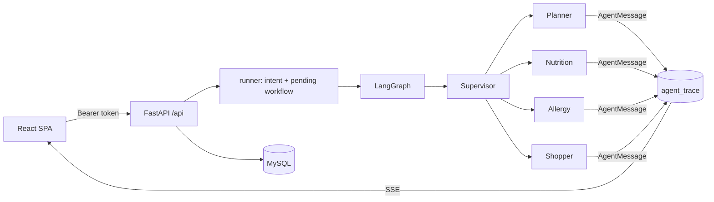

# Architecture Decision Records — NutriGen.ai

NutriGen.ai is a multi-agent meal planner: a supervisor coordinates four specialised
agents, deterministic guardrails decide what is safe, and a React SPA presents the
result for human approval.

This directory records the decisions that a new contributor would otherwise have to
reverse-engineer, and that should not be silently undone later. An ADR explains **why**
the code looks the way it does; the code remains the source of truth for **how**.

- **Format:** short. One page is normal. Sections beyond Context/Decision/Consequences
  are optional.
- **Statuses:** `Accepted`, `Superseded by ADR-NNNN`, `Deprecated`, `Proposed`.
- **Scope:** system-wide, repo-level decisions. Local implementation details belong in
  code comments, not here.
- **Evidence:** links point at the implementation as of 2026-10-22. If a file moves,
  update the link — never rewrite history to match new code.

## Index

| # | Decision | Status | Read it when… |
|---|---|---|---|
| [0001](./0001-supervisor-hub-and-spoke.md) | Supervisor owns the workflow; workers only talk to it | Accepted | adding an agent, a check, or a new workflow branch |
| [0002](./0002-langgraph-topology-custom-agent-loop.md) | LangGraph for topology, custom think–act–observe loop for workers | Accepted | changing agent reasoning, tools, or limits |
| [0003](./0003-deterministic-safety-llm-for-language.md) | Safety rules are code; the LLM handles language and judgement | Accepted | touching guardrails, calorie rules, or prompts |
| [0004](./0004-allergy-veto-and-fail-closed.md) | Allergy veto is absolute and verification fails closed | Accepted | changing checks, error handling, or approval |
| [0005](./0005-llm-first-intent-contract.md) | One structured LLM call classifies intent and extracts parameters | Accepted | adding an intent or a request parameter |
| [0006](./0006-pending-workflow-multi-turn.md) | Multi-turn questions are explicit, client-persisted pending workflows | Accepted | changing confirmations, resume, or cancel |
| [0007](./0007-bounded-revision-rounds.md) | Plans are built in one pass, revised at most 3 rounds, capped at 7 days | Accepted | changing limits or supporting longer plans |
| [0008](./0008-per-agent-llm-routing-and-resilience.md) | Two Gemini keys, per-agent models, retries and a circuit breaker | Accepted | touching model choice, quotas, or LLM failures |
| [0009](./0009-tool-grounded-nutrition-math.md) | Nutrition numbers come from tools; maths is deterministic | Accepted | changing nutrition lookup or portioning |
| [0010](./0010-allergen-taxonomy-and-investigation.md) | Allergen matching uses a canonical taxonomy plus investigation | Accepted | changing allergen data or matching rules |
| [0011](./0011-external-data-fallbacks-and-provenance.md) | External data degrades to AI fallbacks, labelled with provenance | Accepted | changing recipes, prices, or trust labels |
| [0012](./0012-mysql-schema-evolve-in-place.md) | MySQL with startup schema evolution, no migration tool | Accepted | changing tables, deploying, or adding environments |
| [0013](./0013-signed-session-tokens.md) | Stateless HMAC session tokens with a 15-minute absolute lifetime | Accepted | changing auth, sessions, or deployment secrets |
| [0014](./0014-plan-lifecycle-and-versioning.md) | Plans are versioned drafts with idempotent human approval | Accepted | changing plan persistence, statuses, or approval |
| [0015](./0015-trace-hub-and-sse.md) | Agent events are persisted and streamed over SSE | Accepted | changing observability or the live timeline |
| [0016](./0016-frontend-state-and-reload-recovery.md) | React SPA with reload-safe delivery and per-user local history | Accepted | changing frontend state, chat delivery, or sessions |
| [0017](./0017-testing-with-fakes.md) | Tests use fake LLMs/APIs; live-model tests are separate | Accepted | adding tests or changing test infrastructure |
| [0018](./0018-calorie-refusal-and-fast-startup.md) | Strict calorie refusal and fast backend startup | Accepted | changing calorie guardrails, startup behaviour, or init_db |

## Reading paths

- **New to the repo:** 0001 → 0002 → 0005 → 0007 → 0014 → 0016
- **Working on safety:** 0003 → 0004 → 0009 → 0010 → 0011
- **Ops / infrastructure:** 0008 → 0012 → 0013 → 0015 → 0017
- **Frontend / chat UX:** 0016 → 0014 → 0013 → 0006

## System at a glance



A request normally travels like this:

1. The client sends `POST /api/chat` with its bearer token and message.
2. `runner.run_meal_planner` asks the LLM for a typed intent and extracted parameters.
3. Conversational intents are answered directly; planning intents enter the LangGraph.
4. The input guardrail validates age, days, calories, diet, and fixed meals.
5. The Planner drafts; Nutrition and Allergy review in parallel.
6. A deterministic routing function decides: proceed, revise (max 3 rounds), or escalate.
7. The Shopper builds the grocery list; the output guardrail re-checks the whole result.
8. The plan is saved as a draft and shown to the user; approval is a separate, idempotent step.

## Vocabulary

- **Plan** — the persisted entity (`plans` + `plan_meals`) holding one user's multi-day meals.
- **Draft / reviewing / approved** — plan lifecycle states. Only `approved` means the user accepted it.
- **Round** — one Planner draft followed by Nutrition + Allergy review and a supervisor decision. Capped at 3.
- **Veto** — an allergy failure. It cannot be overruled by nutrition, the planner, or the user within the same run.
- **Pending workflow** — a question the assistant asked that still needs an answer (specs, conflict, confirm).
- **Trace** — the ordered `AgentMessage` log of thoughts, tool calls, drafts, vetoes, and decisions.
- **Provenance** — where a value came from: `api` / `ai_generated` / `user_specified` for recipes; `mandi_api` / `baseline_cache` / `ai_estimate` for prices.

## Adding an ADR

Write one when a decision is all three of:

1. **Costly to reverse** — schema, auth, orchestration shape, safety policy.
2. **Surprising without context** — a reader would ask "why is it like this?"
3. **A real trade-off** — there were alternatives, and the reasons are not obvious.

Do **not** write one for a rename, a bug fix, or a local refactor that stays inside an
accepted decision. If a decision changes, add a new ADR and mark the old one
`Superseded by ADR-NNNN`; do not edit the old rationale.

Numbering: take the highest number in this directory and add one.

## Template

```md
# {Short, opinionated title}

**Status:** Accepted · **Recorded:** YYYY-MM-DD

## Context
What situation forced a choice? What would a reader otherwise assume?

## Decision
What we chose, stated in the active voice.

## Consequences
What this makes easy, what it makes hard, and what debt it creates.

## Code map
- `path/to/file` — what it owns
```
